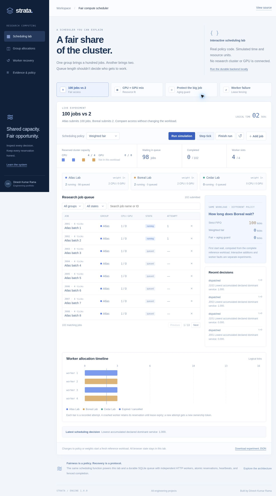

# Strata — Fair Compute Scheduler

**A fair share of the cluster.** A research-job scheduler with an inspectable policy, durable logical resource reservations, and fenced worker recovery.

[Live scheduling lab](https://dk18234.github.io/strata-scheduler/) · [Portfolio](https://dk18234.github.io/dinesh-rama-portfolio/) · [Beginner learning path](guide/LEARNING.md) · [Exact policy](guide/POLICY.md)



One group submits 100 jobs. Another submits two. Strict FIFO makes the smaller group wait 100 logical ticks in the fixed reference workload; weighted scheduling starts its first job at tick 0. Both runs finish at tick 104. These are reproducible synthetic results, not a production throughput benchmark.

The browser runs the actual shared scheduling policy. The full backend uses Node.js, SQLite WAL, atomic reservations, independent HTTP worker processes, lease renewal, bounded retries, and ownership tokens that reject late results after expiry/reassignment.

**CPU/GPU units are logical admission budgets.** The browser simulates time and workers. Local workers execute a small deterministic CPU challenge and wait for the declared runtime. No real GPU, Slurm cluster, OS quota enforcement, or general untrusted-code execution is implemented.

## Explore the lab

- Compare strict FIFO, weighted fair scheduling, and a conservative aging guard.
- Inspect a 100-versus-2 fairness fixture, heterogeneous CPU/GPU jobs, a large waiting job, and a worker-failure drill.
- See live reservations, group budgets, queued jobs, and recorded worker-attempt timelines.
- Add/cancel jobs, change group weights, stop/restart simulated workers, reject stale results, and export the experiment JSON.
- Read every scheduling/recovery decision. Browser state stays in the tab; the demo has no production cluster connection.

## Run the durable queue

Requires **Node.js 24.14+** (built-in `node:sqlite`) and npm:

```bash
npm ci
npm test
export ADMIN_TOKEN="$(node -e 'console.log(require("node:crypto").randomBytes(32).toString("hex"))')"
npm start
```

The server defaults to `http://127.0.0.1:8086` and persists state in `data/strata.db`. In separate terminals using the same token:

```bash
WORKER_ID=worker-a npm run worker
WORKER_ID=worker-b npm run worker
```

Create `jobs.json`:

```json
[
  { "label": "Genome alignment", "group": "atlas", "cpu": 2, "gpu": 0, "ticks": 8 },
  { "label": "Feature extraction", "group": "boreal", "cpu": 1, "gpu": 1, "ticks": 4 }
]
```

```bash
IDEMPOTENCY_KEY=example-batch node bin/strata.mjs submit jobs.json
node bin/strata.mjs snapshot
node bin/strata.mjs simulate fairness
```

The public browser lab remains a simulation even when served by this local server. The operator API is a separate integration; no token is embedded into the webpage.

## Run the real failure drill

```bash
npm run evidence
```

This writes `reports/fairness.json` and `reports/process-drill.json`. The drill starts independent server/worker OS processes, kills a worker with `SIGKILL` after a confirmed claim, kills/restarts the server against the same SQLite file, waits for reassignment, posts the original token, and verifies:

- committed jobs survive the server restart;
- the expired attempt cannot commit after a fresh claim;
- all three jobs eventually succeed with exactly three accepted completions;
- each observed snapshot respects cluster/group budgets;
- all reservations are released on completion.

Tokens remain in process memory and are not written into evidence. The worker workload is deterministic; the server independently verifies its result. Repeated successful completion with the same token/result is idempotent.

## Scheduling policy

Weighted mode orders eligible group heads by accumulated declared service:

```text
charge = max(job CPU / cluster CPU, job GPU / cluster GPU) × declared ticks / group weight
```

FIFO order is preserved within a group. Quotas and worker slots are checked before a claim. The aging guard reserves opportunity by draining conflicting new work for an old blocked job; it does not preempt work or predict a backfill reservation time.

This is a bounded, nonpreemptive **declared-cost** policy inspired by multi-resource fairness. It is not the formal Dominant Resource Fairness allocation algorithm and does not claim strategy-proofness, optimal utilization, or general starvation bounds. Charges persist across retries and are not refunded for cancellation. See [policy and limitations](guide/POLICY.md).

## API

Except `/health` and static files, all routes require `X-Admin-Token` (at least 24 characters).

| Route                           | Purpose                                                                               |
| ------------------------------- | ------------------------------------------------------------------------------------- |
| `POST /api/jobs`                | Submit one job or `{ "jobs": [...] }`; requires `Idempotency-Key`                     |
| `GET /api/snapshot`             | Consistent queue, budgets, attempts, workers, and recent events; no ownership secrets |
| `POST /api/workers/claim`       | Claim using `{ "worker": "worker-a" }`                                                |
| `POST /api/jobs/{id}/heartbeat` | Renew current attempt with `{ "token": "..." }`                                       |
| `POST /api/jobs/{id}/complete`  | Verify/commit `{ "token": "...", "result": "..." }`                                   |
| `POST /api/jobs/{id}/cancel`    | Cancel queued/running work and revoke ownership                                       |

Claims, capacity checks, service charges, ownership, and reservation insertion share one `BEGIN IMMEDIATE` transaction. Expiry, cancellation, and completion release reservations in their own atomic transitions. WAL and `synchronous=FULL` support durability of committed transactions, subject to filesystem/storage behavior. SQLite is a local single-writer coordinator, not a distributed database.

## Docker Compose

```bash
# Keep ADMIN_TOKEN set from the command above.
docker compose up --build
```

Compose runs the queue and three separate workers. The host port binds only to `127.0.0.1:8086`; the SQLite file lives in a named volume. The image runs as a nonroot user. Stop a worker container to exercise lease recovery. Reopening a queue requires the same persisted configuration; use another data path for another experiment.

## Verification and learning

`npm test` builds the shared browser engine, CLI, queue, and workers, then runs policy, protocol, HTTP, concurrent-process, browser parity, and actual process-kill checks. GitHub Actions also runs a nonroot/read-only container test. [Verification record](guide/VERIFICATION.md), [architecture](guide/ARCHITECTURE.md), [operations](guide/OPERATIONS.md), and [learning guide](guide/LEARNING.md) explain exactly what is tested and how to reverse-engineer the system.

Created for **Dinesh Kumar Rama**, with AI-assisted implementation and synthetic research workloads. Understand and modify the code before claiming independent implementation expertise. No real university cluster use, customer impact, GPU execution, or production adoption is claimed.

MIT licensed. References: [Dominant Resource Fairness, NSDI 2011](https://www.usenix.org/conference/nsdi11/dominant-resource-fairness-fair-allocation-multiple-resource-types), [Node SQLite documentation](https://nodejs.org/download/release/latest-v24.x/docs/api/sqlite.html), [SQLite WAL](https://www.sqlite.org/wal.html).
