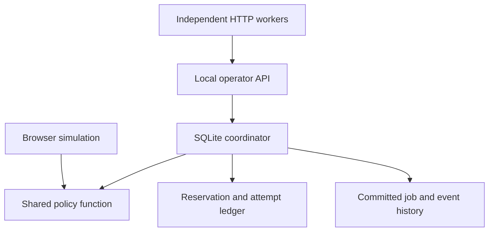
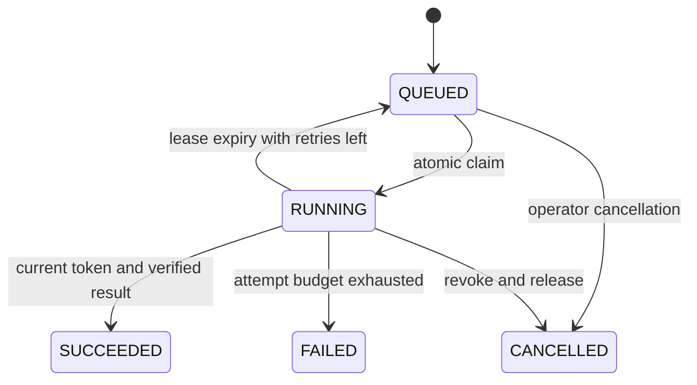

# Architecture

Strata separates policy from ownership. The pure TypeScript planner decides which queued job is eligible. The coordinator makes that decision concrete in one database transaction. Independent workers hold temporary permission to finish a job.

## Transaction boundary

`QueueStore.claim` begins an immediate SQLite transaction, recovers expired work, rejects duplicate active ownership by one worker, reads a consistent queue/allocation view, selects an eligible job, reserves capacity, charges its group, creates a random attempt token, records an event, checks invariants, and commits. Another process cannot insert a conflicting reservation between the capacity read and write.

Heartbeat, completion, cancellation, and expiry are separate atomic transitions. The server's clock is authoritative; workers do not submit lease timestamps. The attempt token is returned only to the claimant, hashed in the database, omitted from snapshots, and invalidated on ownership changes. Rejection events are committed even though the API returns a conflict.

## Real processes versus browser time

The browser uses integer ticks, synthetic workers, three-tick leases, and a recorded segment per attempt. The durable backend uses wall-clock milliseconds, SQLite state, a bounded lease, and a hard runtime deadline. Both invoke `selectJob`; they use different clocks/adapters and do not claim identical wall-clock throughput.

The Node worker executes a small PBKDF2-based deterministic CPU challenge asynchronously and waits out the declared duration. The server independently derives the expected result before accepting it. The GPU field affects only logical admission and challenge input; no GPU code is run. Worker processes are trusted local agents, not a sandbox for arbitrary scripts.

## Files

| Source                      | Responsibility                                           |
| --------------------------- | -------------------------------------------------------- |
| `src/core/model.ts`         | Typed jobs, groups, budgets, validation, invariants      |
| `src/core/planner.ts`       | Pure policy and aging guard                              |
| `src/core/simulation.ts`    | Deterministic browser/local model and reference fixtures |
| `src/store.ts`              | Durable SQLite state machine and transactions            |
| `src/server.ts`             | Token-protected HTTP adapter and static lab              |
| `src/worker.ts`             | Independent HTTP worker loop                             |
| `src/workload.ts`           | Deterministic synthetic CPU challenge                    |
| `src/cli.ts`                | Submission, snapshot, and reference comparisons          |
| `src/web/`                  | Simulation UI and presentation                           |
| `scripts/process-drill.mjs` | Real process failure/restart evidence                    |

The coordinator is single-host and SQLite serializes writes. Multiple independent claim processes are tested, but multi-host coordinator HA, network partitions, clock rollback, database failover, hardware placement, and production batch-system integration are not implemented. The event ledger is bounded; it is not an immutable external audit service.
